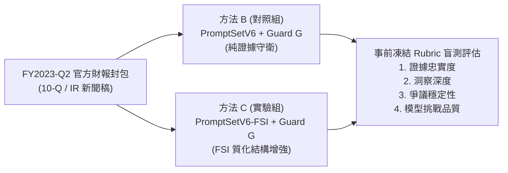

# FSI-S2 模型對比實驗執行工單 (Execution Workorder)

| 欄位 | 內容 |
|---|---|
| 工單編號 | `STOCKOS-FSI-S2-WORKORDER-001` |
| 狀態 | **SPECIFICATION_FROZEN / READY_FOR_AUTHORIZATION** |
| 日期 | 2026-10-07，Australia/Brisbane |
| 目標目標庫 | `1121eason/StockOS` |
| 前置依賴 | S1 離線工程通過（116 passed）；M4.1 真人審核通過（35/35 完成，合格率 100%） |
| 執行類型 | **受控單季（FY2023-Q2）真實模型對比推論實驗** |
| 授權邊界 | **本工單僅定義規格與離線預備；真實模型調用需取得使用者明確指令方可解鎖** |

---

## 1. 實驗目標與核心假設

在 Guard G 修復了歷史空支持與角色重疊缺陷後，本實驗旨在回答核心科學問題：
> **「在相同的嚴格證據准入規則（Guard G）下，引入 FSI 質化研究結構（方法 C）是否真能比純基線（方法 B）產出更深入、更穩定的基本面質化洞察，而非僅依賴守衛的被動攔截？」**

---

## 2. 實驗組別與變因控制（B vs C）

| 變因項目 | 方法 B（對照組：純 Guard G 基線） | 方法 C（實驗組：FSI 增強結構） |
|---|---|---|
| **測試季度** | `FY2023-Q2`（與歷史 V6 run 15 基準完全對齊） | `FY2023-Q2`（相同輸入封包） |
| **輸入上下文** | 相同 PIT 財報原始文本（SHA-256 完全一致） | 相同 PIT 財報原始文本（SHA-256 完全一致） |
| **Prompt 體系** | `PromptSetV6` | `PromptSetV6-FSI`（增加結構化財報洞察指引） |
| **門禁守衛** | `Guard G`（嚴格准入，0 空支持，0 角色重疊） | `Guard G`（相同嚴格准入規則） |
| **分析政策** | `AIAnalystPolicyV3` | `AIAnalystPolicyV3-FSI` |
| **特徵結構** | `FeatureSchemaV2` (28 個特徵) | `FeatureSchemaV2-FSI` (28 個特徵 + 結構化推論) |
| **模型版本** | `gpt-6-astra`（或指定之 `claude-3-5-sonnet`） | 相同模型與版本 |

---

## 3. 嚴格安全與預算防護（Caps & Circuit Breakers）

為確保實驗可控，避免任何 API 費用失控或資料庫污染，本工單設定以下不可逾越之硬性防線：

1. **單季調用上限（Total Call Cap）**：
   - 方法 B：最多 **22 次 API 呼叫**。
   - 方法 C：最多 **22 次 API 呼叫**。
   - 單次實驗合計上限：**44 次調用**。
2. **零外層重試（Zero Outer Retry）**：
   - 遭遇不可恢復之網絡或解析錯誤時，立即 fail-closed 停止，絕不發起外層無限重試。
3. **超時限制（Timeouts）**：
   - Extraction 階段單次呼叫上限：180 秒。
   - Synthesis / Challenge 階段單次呼叫上限：600 秒。
4. **資料庫絕對隔離（Storage Isolation）**：
   - 實驗產物僅寫入專用候選資料庫：`data/m41/fsi/s2/candidate.db`。
   - **嚴格禁止寫入正式 `data/qve.db`**。
5. **程序排他性（Single Process Guarantee）**：
   - 啟動前進行 preflight 檢查，確認本機無殘留之背景模型程序，取得 `active.lock` 獨佔執行權。

---

## 4. 客觀評價標準（Evaluation Rubric）

實驗完成後，將由真人專家依據以下 5 大客觀維度進行盲測評分：

| 評估維度 | 評估指標 | 期望目標 |
|---|---|---|
| **1. 證據忠實度** | 引用之 span 是否 100% 來自官方 10-Q / 新聞稿原文 | 100% 忠實，0 幻覺 |
| **2. 守衛通過率** | 產物符合 Guard G 准入條件之比例（空支持率 / 角色重疊率） | 違規率 0% |
| **3. 核心爭議穩定性** | 在 `competition_outlook`（跑分 vs 渠道）與 `pricing_power` 是否能給出具備微觀邏輯的穩健定性 | C 明顯優於 B（能區分假設與事實） |
| **4. 質化洞察深度** | 是否精準指出資料中心產品轉換、庫存調整週期與網絡芯片長交期之本質 | 具備機構投資者等級之質化深度 |
| **5. 模型挑戰品質** | 對量化估值模型提出的 Advisory Challenges 是否切中毛利率與現金流盲點 | 挑戰論據充分，建議具可操作性 |

---

## 5. 執行步驟與驗收路徑

1. **Step 1（離線演練）**：執行 `scripts/run_fsi_s2_experiment.py --dry-run`，驗證封包、鎖定與 schema 正確（API 調用數 = 0）。
2. **Step 2（授權審查）**：呈報使用者，確認預算與調用上限。
3. **Step 3（Live 執行）**：取得明確授權後，啟動真實 Q2 推論。
4. **Step 4（盲測判讀）**：真人專家依 Rubric 進行 B vs C 成果比對。
5. **Step 5（升格決策）**：若 C 證明具備顯著優勢，正式提出 Promotion 方案。
